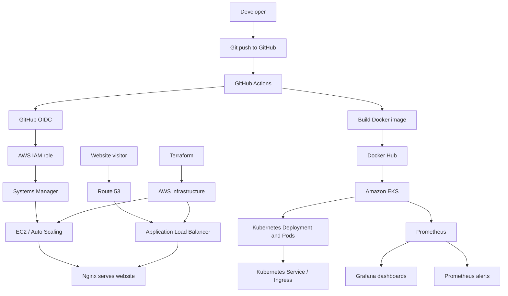

# KumarStack — End-to-End DevOps Portfolio

**Website:** [kumarstack.com](https://kumarstack.com)
**GitHub:** [@pranay9528](https://github.com/pranay9528) · **Repository:** [Devopsreal](https://github.com/pranay9528/Devopsreal)
**LinkedIn:** [Pranay S.](https://linkedin.com/in/pranay-s-911864196)

KumarStack is a hands-on DevOps and cloud engineering portfolio project. It brings together infrastructure as code, a containerised website, CI/CD automation, Kubernetes deployment, and monitoring in one repository. The goal is to demonstrate how the pieces connect across an application's delivery lifecycle—not just list tools on a page.

> **Cost-aware operations:** cloud demo resources are brought online for testing and demonstrations, then torn down when they are not needed to avoid unnecessary AWS charges.

---

## Project at a glance

- **Infrastructure as Code:** Terraform for AWS networking and application infrastructure.
- **Cloud platform:** AWS, including VPC networking, EC2 Auto Scaling, Application Load Balancer, IAM, Route 53 and ACM.
- **Containers:** Docker and Docker Hub, with versioned image tags.
- **CI/CD:** GitHub Actions workflows for infrastructure checks, Docker image publishing, and deployment.
- **AWS authentication:** GitHub Actions uses OpenID Connect (OIDC) to assume an AWS IAM role, avoiding long-lived AWS access keys in GitHub secrets.
- **Orchestration:** Kubernetes on Amazon EKS, with Deployments, Services, Ingress, ConfigMaps and Secrets.
- **Monitoring:** Prometheus, Grafana and a PrometheusRule alert for container restarts.
- **Web serving:** Nginx serves the KumarStack static website.

## Architecture

The project demonstrates two related delivery paths: the website hosted on AWS infrastructure, and a container image deployed to Kubernetes.



### Delivery flows

**Website deployment to EC2**

1. A change is pushed to the `main` branch.
2. GitHub Actions authenticates to AWS using OIDC and an IAM role.
3. The workflow uses AWS Systems Manager to run the deployment script on the EC2 application environment.
4. The deployment script copies the website into Nginx's web root and restarts Nginx.

**Container deployment to EKS**

1. GitHub Actions checks out the repository and builds the Docker image from `docker-project/`.
2. The image is tagged with the commit SHA and pushed to Docker Hub.
3. The workflow configures `kubectl` for the EKS cluster and updates the Kubernetes Deployment image.
4. The workflow waits for the rollout to complete.

The EKS workflow requires the cluster and its supporting access configuration to exist when the deployment job runs. Demo infrastructure is managed with cost in mind rather than left running continuously.

---

## Repository layout

```text
.
├── .github/
│   └── workflows/          # GitHub Actions CI/CD workflows
├── terraform-project/      # Terraform infrastructure and EC2 bootstrap scripts
│   └── scripts/
│       └── user-data.sh    # Instance initialisation
├── docker-project/         # KumarStack website and container configuration
│   ├── Dockerfile
│   ├── docker-compose.yml
│   ├── website/
│   │   └── index.html
│   └── scripts/
│       └── deploy.sh       # Website deployment script
├── kubernetes-project/     # EKS configuration and Kubernetes workload manifests
├── monitoring/             # PrometheusRule and monitoring configuration
├── docs/
│   └── labs/               # Preserved Docker / Compose learning labs
└── README.md
```

## Technology stack

| Area | Tools and services | Purpose in this project |
|---|---|---|
| Cloud | AWS | Hosting and managed cloud services |
| Infrastructure as Code | Terraform | Repeatable infrastructure definitions |
| Networking and delivery | VPC, ALB, EC2 Auto Scaling, Route 53, ACM | Network, application entry point, scaling, DNS and TLS |
| Instance operations | AWS Systems Manager (SSM) | Run deployment commands on EC2 without relying on SSH in the pipeline |
| Containers | Docker, Docker Compose, Docker Hub | Package the website and publish versioned images |
| CI/CD | GitHub Actions | Automate validation, image publishing and deployments |
| Identity and access | AWS IAM, GitHub OIDC | Short-lived role assumption for workflow access to AWS |
| Orchestration | Kubernetes, Amazon EKS, kubectl | Deploy and roll out containerised workloads |
| Traffic routing | Kubernetes Service and Ingress; AWS load balancer integration | Expose workloads through cluster networking and AWS load balancing |
| Monitoring | Prometheus, Grafana, Prometheus Operator | Metrics, dashboards and alert rules |
| Web serving | Nginx, HTML, CSS, JavaScript | Serve the KumarStack portfolio website |

---

## Engineering work demonstrated

### Infrastructure as Code

- Defined AWS infrastructure using Terraform.
- Worked with networking, load balancing, EC2 Auto Scaling, IAM, DNS and TLS configuration.
- Separated infrastructure definitions from application deployment code.
- Used Terraform plan/review workflows to inspect infrastructure changes before applying them.

### Application delivery and containers

- Built an Nginx-based Docker image that packages the website from `docker-project/website/`.
- Used Docker Compose for local container exercises.
- Published versioned Docker images to Docker Hub, including commit-SHA tags from CI/CD.
- Kept the application build context separate from Terraform infrastructure.

### CI/CD and AWS access

- Created GitHub Actions workflows to build and push images and deploy the application.
- Configured GitHub-to-AWS authentication with OIDC and an IAM role instead of storing long-lived AWS access keys in GitHub.
- Used Systems Manager to invoke application deployment commands on EC2.
- Configured a Kubernetes rollout step so the deployment workflow waits for the new version to roll out.

### Kubernetes and monitoring

- Deployed workloads using Kubernetes Pods and Deployments, scaled replicas, and tested rollout and rollback behaviour.
- Worked with Services, Ingress, ConfigMaps and Secrets.
- Installed the Prometheus/Grafana monitoring stack with Helm.
- Added a PrometheusRule to alert on container restarts.

### Troubleshooting and operational awareness

- Investigated EC2 bootstrap and Nginx setup problems that caused load-balancer targets to be unhealthy.
- Used instance logs and cloud-init scripts to diagnose startup configuration problems.
- Compared EC2-hosted deployment with a container-to-EKS deployment path.
- Removed demo infrastructure when it was not required to limit ongoing cloud costs.

---

## Run the website locally

Prerequisites: Docker installed and running.

From the repository root:

```bash
docker build -t kumarstack:local ./docker-project
docker run --rm --name kumarstack-preview -p 8080:80 kumarstack:local
```

Open [http://localhost:8080](http://localhost:8080). Press `Ctrl+C` in the terminal to stop the preview container.

You can also run the Compose configuration from the Docker project directory:

```bash
cd docker-project
docker compose up
```

Then open [http://localhost:8080](http://localhost:8080), provided the port is available. Stop the Compose services with `docker compose down`.

## Security notes

- Never commit real credentials, private keys, Terraform state, or sensitive variable files.
- GitHub Actions should receive AWS access through the configured OIDC role and least-privilege IAM permissions.
- Treat example Kubernetes Secret manifests as demonstrations only. Do not put production passwords or API keys in Git; use an appropriate secret-management solution for real deployments.
- Review `terraform plan` and expected AWS charges before applying infrastructure changes.

## Current status and reproducibility

KumarStack has been built and tested in stages, including the website deployment path, Docker image publishing, Kubernetes workload exercises, and monitoring setup. The cloud demonstration environment is managed with cost awareness, so an AWS or EKS environment may need to be provisioned before repeating an end-to-end deployment. A successful GitHub Actions run depends on the relevant AWS resources, IAM permissions, cluster access and Kubernetes deployment being available.

This repository documents a practical project and its implementation, not a claim that every demonstration resource runs 24/7.

## Connect

- **Website:** [kumarstack.com](https://kumarstack.com)
- **GitHub:** [github.com/pranay9528](https://github.com/pranay9528)
- **Project repository:** [github.com/pranay9528/Devopsreal](https://github.com/pranay9528/Devopsreal)
- **LinkedIn:** [linkedin.com/in/pranay-s-911864196](https://linkedin.com/in/pranay-s-911864196)

---

*Built by Pranay as a hands-on DevOps and cloud engineering portfolio project.*
